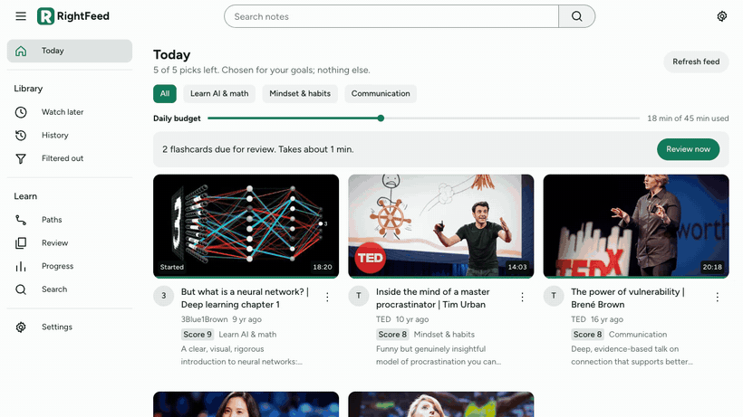

# RightFeed

**The right videos for your goals, instead of the endless scroll. A goal-driven feed for YouTube.**

<a href="docs/demo.mp4"></a>

<sub>44 second demo with sample data. Select it to open the full video.</sub>

The home feed on most video platforms is built to keep you watching. RightFeed starts from the opposite question: what are you trying to get better at? You name your goals, and it finds videos that serve them, drops the rest, and gives you a short lineup that stays put until you finish it. There is no infinite scroll, no autoplay and no recommendations column.

It runs on your own machine, with your own API keys, and your data stays in one local SQLite file.

RightFeed is an independent project. It is not affiliated with or endorsed by YouTube or Google.

## How it works

```
Your channels ─┐
Goal searches ─┼─> Hard rules ─> AI scoring ─> Daily lineup ─> Watch ─> Notes, quiz, flashcards, action step
RSS feeds ─────┘   (Shorts,      (0 to 10,     (balanced
                   length,       with a        across goals)
                   keywords)     reason)
```

Every filtered video stays visible with the reason it was dropped, so you can check the scoring and rescue anything it got wrong.

## Features

**Choosing what to watch**
- Goals drive everything. Every video has to serve one of them.
- Write your own rules in plain English, such as "no motivational fluff without concrete advice".
- Ratings and dropped videos feed back into the scoring.
- The lineup keeps each place until you finish that video. Drop one and a new pick takes its spot.

**Watching on purpose**
- Write down why you are watching before a video plays.
- A daily time budget counts real playing time and locks the player when it runs out.
- A Watch later playlist with Play all, Next and Move to top.

**Keeping what you learn**
- AI summaries and recall quizzes.
- Flashcards with spaced repetition (SM-2). Make them from a video or write your own, and they come back just before you would forget them.
- Timestamped notes that jump back to the moment.
- Action steps that stay on your home page until done.
- Search across your notes, transcripts and summaries.

**Building your own paths**
- Paths start empty. Give one a name, a description and your own sections.
- Paste a YouTube link or use Add to path on any video, then reorder as you like.
- Videos you add stay out of your feed, and AI can draft a path from a goal if you prefer.

**Tracking progress**
- Your streak, the last 14 days, time per goal, quiz accuracy and a weekly reflection.
- A read-only share link for an accountability buddy. It shows goals, streak and finished actions, never your notes.

## Quick start

You need Node.js 22.13 or newer.

```bash
git clone https://github.com/rupeshpoojary9/RightFeed.git
cd RightFeed
npm install
npm run seed:demo   # optional: load sample data to look around first
npm run dev         # http://localhost:3000
```

For your real setup, skip the demo data, then copy the example config and add your keys:

```bash
cp .env.example .env.local
```

The first run walks you through your goals and channels.

### API keys

RightFeed runs without any keys, using RSS and simple keyword matching. Each key unlocks more, and you pay for your own usage. Every setting is explained in [`.env.example`](.env.example).

| Key | What it adds | Cost |
| --- | --- | --- |
| YouTube Data API | Search by goal, full channel uploads, reliable Shorts detection | Free, 10,000 units a day. RightFeed uses about 200 per goal per day |
| AI API | Scoring, summaries, quizzes, flashcards, paths, reflections | Pay per use |
| TypeSafe (optional) | Score videos with [Jev](https://typesafe.ai) instead. It handles scoring only, so summaries and quizzes still use the AI API. Set `JUDGE_PROVIDER=jev` if both keys are present | Pay per use |

Create the YouTube key in the [Google Cloud Console](https://console.cloud.google.com/apis/library/youtube.googleapis.com): enable *YouTube Data API v3*, then choose *Credentials*, *Create API key*.

## Keeping the feed fresh

The feed refreshes when you open the app, if the last refresh was more than 6 hours ago. To schedule it instead, keep the server running and add a cron job:

```bash
0 */6 * * * cd /path/to/RightFeed && npm run refresh
```

## Development

```bash
npm test            # unit tests
npm run typecheck
npm run build
```

Built with Next.js 16, React 19 and SQLite through Node's built-in `node:sqlite`, so there are no native dependencies. Node prints an "SQLite is experimental" warning on startup, which is harmless.

```
app/            pages and server actions (app/actions.ts)
components/     UI components
lib/ingest.ts   refresh pipeline: fetch, hard rules, scoring, lineup, time budget
lib/paths.ts    helpers for building your own paths
lib/ai.ts       scoring, summaries, quizzes, flashcards, paths, reflections
lib/jev.ts      optional Jev scorer
lib/youtube.ts  RSS, YouTube Data API, transcripts
lib/learn.ts    spaced repetition, stats, weekly reflection
lib/db.ts       SQLite helpers (schema in lib/schema.sql)
scripts/        refresh trigger and demo data
tests/          unit tests
```

## Security and privacy

- RightFeed is built for one person. It has no user accounts.
- `npm run dev` and `npm start` listen on `127.0.0.1` only, so other devices cannot reach it by default.
- Your goals, notes, history and transcripts stay in `data/rightfeed.db`, which git ignores. Video titles, descriptions, transcripts and your rules are sent to the AI services you configure.
- Keys belong in `.env.local`, which git also ignores. Never commit them.

**Hosting it yourself:** set `APP_PASSWORD` first, then run `npx next start -H 0.0.0.0` on a host with a persistent disk. Every page then asks for that password, except the read-only `/share/<token>` page. Put it behind HTTPS, since the password travels with each request. Do not host it for other people: there is one database and one set of keys, and anyone with the password can add feed URLs for the server to fetch.

Found a vulnerability? Please report it privately through GitHub's security advisories rather than a public issue.

## Limits

- Videos play in YouTube's embedded player, so ads may appear.
- Transcripts are best effort and use an unofficial endpoint that can break at any time. When one is unavailable, summaries and quizzes use the video description, and the app says so.
- Check the [YouTube API Services Terms](https://developers.google.com/youtube/terms/developer-policies) before you use or adapt this project. You are responsible for how you use your own API key.

## License

[MIT](LICENSE)
